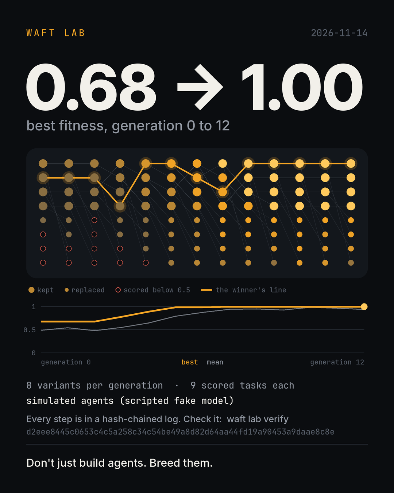

# The lab: directed evolution you can check

`waft lab` breeds variants of an agent on real tasks, writes down everything that happened
in a log nobody can quietly edit, and turns the run into a card and a short video.



## Try it

```bash
waft lab run        # breed, record, and write the card, replay page and video
waft lab show       # what the newest run says happened
waft lab verify     # re-derive every hash of the newest run
waft lab doctor     # prove the lab works on this machine
```

Nothing needs a network or a key. A run with the default settings takes a few seconds and
writes one folder under `lab-runs/`.

## What a run does

1. **Controls.** Three agents with known scores go first: one that says nothing must score 0,
   one that always knows the answer must score 1, and one that needs a single repair must
   land in between. If the scoring cannot tell these apart, nothing after it means anything.
2. **Generation 0.** A population of random variants. Each has a genome and an id that is the
   hash of that genome, so two different variants can never share an id.
3. **Scoring.** Every variant attempts every quest in the Jungle Gym (`waft.gym`). The gym
   checks the answer with WAFT's own validators, classifies what broke, and gives the agent
   up to three tries to repair it. An encounter that never produces a valid answer scores 0.
   A valid first answer scores 1. A valid answer after a repair scores less.
4. **Selection.** The best half carry over unchanged. The rest are replaced by mutated
   children of the kept ones.
5. **Repeat** for the number of generations asked for.
6. **Record.** The whole run is written as a Logbook (`waft.record`): a chain of records, each
   carrying the hash of the one before, plus the stored artefacts they cite. The last hash,
   the *head*, is printed.

## Who the agents are

| `--agent` | What it is | Network |
|---|---|---|
| `scripted` (default) | A system prompt assembled from switchable rules, sent through the real client to a scripted fake model that makes the mistakes small models make. | none |
| `mock` | Three probabilities (break syntax, break logic, manage a repair) drive a stand-in. | none |
| `model` | The same prompt genomes in front of a real model, any server that speaks `/chat/completions`. | yes |

The first two are simulations. A result against them shows that the loop, the scoring and
the record work. It says nothing about any real model, and every picture made from such a
run says "simulated agents" on it.

For a real model, name it in the environment. A local one needs no key:

```bash
WAFT_LLM_BASE_URL=http://localhost:11434/v1 WAFT_LLM_MODEL=llama3.2 waft lab run --agent model
```

A hosted one adds `WAFT_LLM_API_KEY`. Up to four fallbacks (`WAFT_LLM_2_BASE_URL` and so on)
are tried in order when a provider rate-limits or fails. `--max-calls` caps how many model
calls a run may make (default 2000); a run that hits the cap ends at its last full
generation and says so in the record.

## Check a run yourself

```bash
waft lab verify docs/lab/example/20261114T192828Z-lab-scripted-seed-7-b218 \
  --expect-head d2eee8445c0653c4c5a258c34c54be49a8d82d64aa44fd19a90453a9daae8c8e
```

That is the example run in this repository and the head it had when it was made. `verify`
trusts nothing stored in the run: it recomputes every hash, every flag and every verdict.
Two verifiers do this and share no code: one in Python, one in Node written from the
specification alone (`src/waft/record/CUSTODY.md`).

Two fingerprints, on purpose:

- The **head** names one recorded run, with its time and machine. It is different every
  time. Verifying against a head that was published somewhere else (a commit, a post) shows
  the log has not been edited since.
- The **result digest** names what the loop computed. With simulated agents it is the same
  for the same settings on any machine: the example's is
  `87484831a39a8de722ea26ac8bb01a3fb5c9c8a1daaa3e89e73ef31c3ef81a71`, and `waft lab run`
  with no options prints the same one.

A chain like this shows tampering; it cannot prevent it. Someone who rewrites every record
and recomputes every hash makes a chain that verifies on its own. Only a head published
where they cannot reach exposes that, which is why the head above is in this file and not
only beside the run.

## Share a run

`waft lab share` (also run at the end of `waft lab run`) writes into the run's `share/` folder:

| File | What |
|---|---|
| `card.png` | 1080 x 1350. Where the best fitness started and where it ended, the family tree, the head. |
| `replay.mp4` | 1080 x 1920, about 14 seconds: the tree growing generation by generation. Needs `ffmpeg`; without it a smaller `replay.gif` is written. |
| `replay.html` | One self-contained page: the tree, every generation's numbers, the champion's prompt, the controls and checks, and the verify command. |

Every number on them is read from the recorded run. A run that does not verify is refused.

## What this does and does not show

It shows:

- the loop improves the score on the gym's three quests (0.68 to 1.00 in the example);
- the scoring can fail and can pass (the controls);
- the same settings give the same result (the run is replayed and the digests compared);
- the record has not been edited since its head was published.

It does not show:

- that a real model improves. The example's agents are a script. Run `--agent model` for that.
- that a high score here predicts anything about other work. The gym has three quests, all
  about turning text into a valid decision matrix, and the example's agents reach the top
  score by generation 7. Harder and held-out tasks are the next step.
- that evolving a prompt beats writing a good one by hand. Nothing here measures that yet.

## Where the pieces came from

| Piece | Source |
|---|---|
| The gym (`waft.gym`) | WAFT's own `src/gym/rpg`, moved into the package |
| The loop (`waft.lab.engine`) | ported from the FogSift lab harness, `fogsift-system/checks/waft_lab.py` |
| The Logbook (`waft.record`) | copied unchanged from the FogSift system, `fogsift-system/fogsift_api/` |
| The provider client (`waft.lab.llm`) | ported from the Keeper's client, `tavern-keeper-bot/llm.js` |
| The scripted fake model and the network lockdown in tests | the Keeper's test harness, `tavern-keeper-bot/test/helpers/bot.js` |
| The outbound address check | WAFT's own Door Guy, `waft.core.door_guy` |
| Fail-closed scoring, the clock check, planted-defect controls | patterns from `_workbench/snowy-bridge/scripts` and `_pyrite` |
